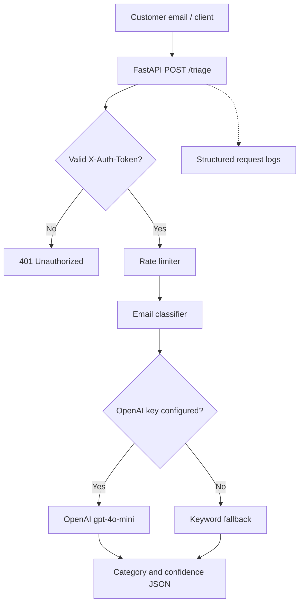

# Brew & Bean Email Triage API

FastAPI service that classifies customer emails into `order`, `feedback`, `support`, or `other`. The `/triage` endpoint requires a token, uses rate limiting, and emits structured request logs.

## Overview

- `POST /triage` — classify an email; requires `X-Auth-Token`
- `GET /health` — health check
- OpenAI `gpt-4o-mini` classification when `OPENAI_API_KEY` is configured
- Keyword-based offline fallback when no key is configured or the provider call fails
- Confidence below `0.6` maps the category to `Uncertain`
- Rate limit: 10 requests per minute per client IP

## Setup

Python 3.12+ recommended.

```bash
python -m venv .venv
```

Activate the environment:
```bash
# macOS/Linux
source .venv/bin/activate
# Windows PowerShell
.venv\\Scripts\\Activate.ps1
```

Install:
```bash
pip install -r requirements.txt
```

Set environment variables in your shell or hosting dashboard. The app does not automatically load `.env`.

macOS/Linux:
```bash
export AUTH_TOKEN="replace-with-a-long-random-secret"
export OPENAI_MODEL="gpt-4o-mini"
# Optional; enables OpenAI classification:
export OPENAI_API_KEY="your-real-key"
```

Windows PowerShell:
```powershell
$env:AUTH_TOKEN="replace-with-a-long-random-secret"
$env:OPENAI_MODEL="gpt-4o-mini"
# Optional:
$env:OPENAI_API_KEY="your-real-key"
```

Run locally:
```bash
uvicorn app.main:app --reload --host 127.0.0.1 --port 8000
```
API docs: http://127.0.0.1:8000/docs

## Architecture



## API Usage

Health check:
```bash
curl http://127.0.0.1:8000/health
```

Triage request (replace URL and token; never publish your token):
```bash
curl -X POST "http://127.0.0.1:8000/triage" \\
  -H "Content-Type: application/json" \\
  -H "X-Auth-Token: replace-with-a-long-random-secret" \\
  -d '{"email":"Where is my coffee order?"}'
```

Example response:
```json
{"category":"order","confidence":0.86}
```
The exact confidence can vary when OpenAI is enabled. Missing/invalid token returns `401`; missing `AUTH_TOKEN` configuration returns `503`.

## Testing

```bash
pytest -q
black --check app tests
flake8 app tests --max-line-length=100
```

Tests cover health, authentication, valid triage, empty email validation, and a basic prompt-injection regression check. This is not a comprehensive security audit.

## Docker

```bash
docker build -t brew-bean-email-triage .
docker run --rm -p 8000:8000 -e AUTH_TOKEN="replace-with-a-long-random-secret" brew-bean-email-triage
```
Add `-e OPENAI_API_KEY="your-real-key"` only if using OpenAI. Do not commit secrets or bake them into the image.

## Render deployment

Create a Render Web Service from this repository. For Docker runtime, use the included `Dockerfile`. Alternatively use build command `pip install -r requirements.txt` and start command `uvicorn app.main:app --host 0.0.0.0 --port $PORT`.

Set these environment variables in Render:
- `AUTH_TOKEN` — long random secret
- `OPENAI_MODEL` — `gpt-4o-mini`
- `OPENAI_API_KEY` — optional, required for OpenAI-powered classification

For auto-deploy from GitHub Actions, create a Render deploy hook and store it as the repository secret `RENDER_DEPLOY_HOOK_URL`. Never put the hook URL in a public file.

## Cost Estimate

API costs depend on model pricing and actual token usage. Check current pricing before submission: https://developers.openai.com/api/docs/models/gpt-4o-mini. Render free tier availability and limits can change: https://render.com/docs/free. The keyword fallback does not make OpenAI calls. OpenAI use may incur charges.

## Limitations

- Offline fallback uses simple keywords and may misclassify messages.
- OpenAI mode depends on API availability and may incur usage charges.
- The in-memory rate limiter is for a small single-instance demo, not a multi-instance production system.
- A single shared token is not full user identity management.
- The injection test is a lightweight regression check, not a complete security evaluation.
- Avoid sending passwords, payment details, or other sensitive customer information.

## Demo

**Live demo video: pending.** Replace this line with a working public or unlisted video link after recording a genuine request against the deployed API. Do not describe a simulated walkthrough as a live API test.

## Handover

See `signoff_template.md` for the client review and acceptance template.
